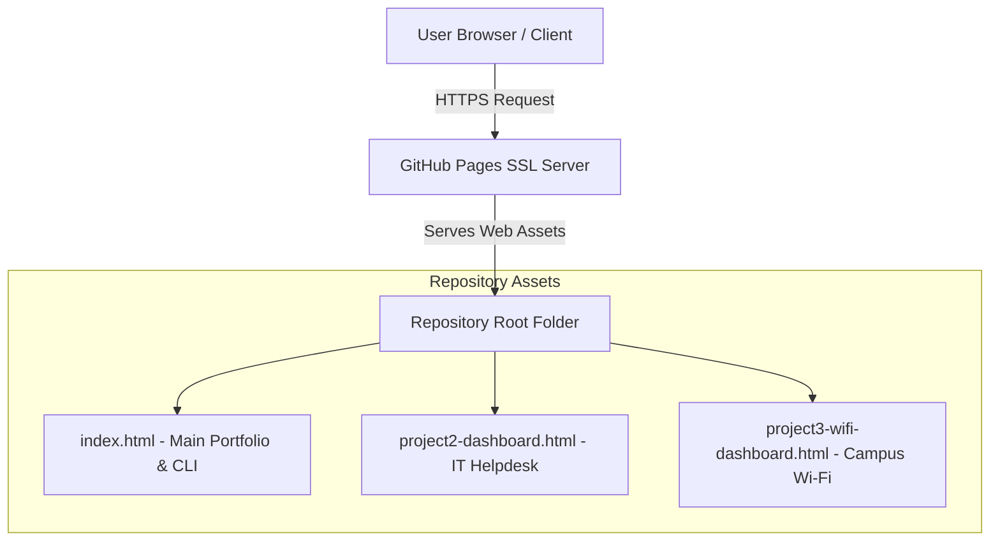

# 1. Project Title
**Industry-Ready BSIT Personal Portfolio Website**

---

## 2. Project Overview
A responsive single-page web application designed and built to showcase my technical capabilities, academic achievements, interactive analytics dashboards, and professional readiness as a BSIT student at Datamex College of Saint Adeline. The project features custom visual styling, responsive design, and integrated project modules.

---

## 3. Problem Statement
Entry-level IT applicants often struggle to demonstrate practical technical skills, project deployment experience, and systematic troubleshooting capabilities through traditional static resumes alone.

---

## 4. Objectives
* Build a responsive front-end portfolio using modern HTML5, CSS3, and JavaScript.
* Integrate live access to Project 2 (IT Helpdesk Ticketing) and Project 3 (Campus Wi-Fi Analytics) dashboards.
* Demonstrate real-world technical problem-solving, cybersecurity case studies, and responsible AI usage.
* Deploy the application live via GitHub Pages with active HTTPS encryption.

---

## 5. Target Users
* IT Recruiters and Hiring Managers
* Academic Portfolio Defense Evaluators / Panelists
* Fellow Web Developers and IT Students

---

## 6. Technologies Used
* **Front-End:** HTML5, CSS3 (Custom Responsive Layouts, Red/Blue Ambient Glow Effects), JavaScript (ES6+)
* **UI/UX Design:** Figma (Layout Wireframing)
* **Version Control & Hosting:** Git, GitHub, GitHub Pages (HTTPS)
* **Diagnostics & Data:** Command Prompt (CLI), Microsoft Excel (Pearson Correlation Analysis)

---

## 7. System Features
* **Interactive Navigation:** Smooth-scrolling section links and dynamic layouts.
* **Ambient Glow Theme:** Custom minimalist design complemented by red and blue glowing accents.
* **Embedded CLI Terminal Simulator:** Interactive command line interface displaying system diagnostics (`BIANCA-MSI-LAPTOP`).
* **Integrated Dashboards:** Direct hyperlinks to `project2-dashboard.html` and `project3-wifi-dashboard.html`.
* **Reflection & Career Plan Cards:** Structured HTML containers for IT career roadmaps and final reflections.
* **Skills Inventory Table:** Comprehensive list of technical skills with corresponding evidence.

---

## 8. System Architecture


---
---

## 9. Database Design
* **Architecture:** Client-side / Static File System.
* **Data Handling:** Dynamic datasets (e.g., 50 campus Wi-Fi RSSI records for Project 3) are structured directly within client-side JavaScript arrays and DOM elements for fast performance without requiring backend server latency.

---

## 10. Screenshots
*(Attach screenshots of your portfolio home section, terminal simulator, and dashboard pages here)*
* `screenshot-homepage.png` — Main Portfolio Hero Section with Red/Blue Accent Theme
* `screenshot-terminal.png` — Interactive CLI Terminal Simulator
* `screenshot-dashboards.png` — Embedded Data Analytics Dashboards

---

## 11. Installation
To run this project locally on your machine:

1. Clone the GitHub repository:
   ```bash
   git clone [https://github.com/your-username/your-portfolio-repo.git](https://github.com/your-username/your-portfolio-repo.git)
